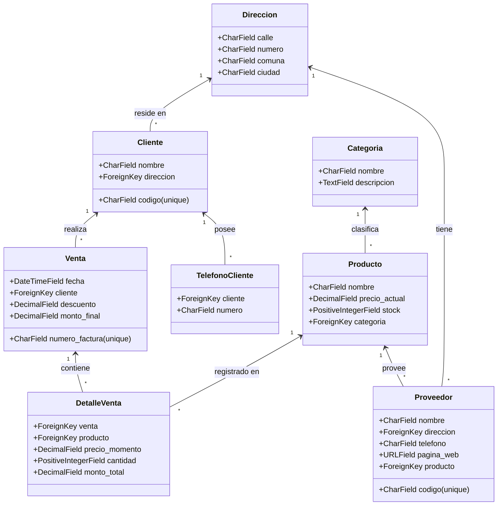

# Laboratorio N° 03: Creación de Modelos en Django

**Institución:** Tecsup  
**Curso:** Desarrollo de Aplicaciones Empresariales
**Tema:** Creación de Modelos, ORM y Migraciones en Django  

---

## 📋 Actividad 1: Revisión de Conceptos / Marcos de Trabajo

| Concepto / Principio | Definición, comentarios o interpretación |
| :--- | :--- |
| **1. Modelo (Model) en Django** | Es una clase en Python que hereda de `django.db.models.Model` y representa una tabla dentro de la base de datos relacional. En ella se definen los campos (columnas), tipos de datos, restricciones y comportamientos de la entidad, abstrayendo la sintaxis SQL directa mediante código Python limpio y mantenible. |
| **2. ORM (Object-Relational Mapping)** | Es la capa de abstracción de Django que traduce y vincula los objetos y clases de Python con las tablas y registros de una base de datos relacional (como SQLite, PostgreSQL o MySQL). Permite realizar operaciones CRUD (crear, leer, actualizar, eliminar) utilizando métodos orientados a objetos (`objects.all()`, `objects.filter()`, etc.) sin escribir consultas SQL manuales. |
| **3. Migraciones (`makemigrations` / `migrate`)** | Es el sistema de control de versiones del esquema de base de datos en Django. `python manage.py makemigrations` inspecciona los cambios realizados en los archivos `models.py` y genera archivos de migración (código Python descriptivo). Por su parte, `python manage.py migrate` aplica dichas operaciones a la base de datos real, creando o alterando las tablas correspondientes. |
| **4. Tipos de campos en modelos Django** | Son clases proporcionadas por `django.db.models` que determinan el tipo de dato SQL en la columna (ej. `CharField`, `IntegerField`, `DateTimeField`, `DecimalField`, `URLField`) y sus restricciones (longitud máxima, valores por defecto, claves foráneas `ForeignKey` para relaciones 1 a N, `ManyToManyField`, o `OneToOneField`). |

---

## 🚀 Estructura del Proyecto

```text
lab_03/
├── lab03/                 # Configuración principal del proyecto Django
│   ├── __init__.py
│   ├── asgi.py
│   ├── settings.py        # Configuración modular, apps y seguridad
│   ├── urls.py            # Rutas principales y redirecciones
│   └── wsgi.py
├── encuesta/              # Aplicación de Encuesta (Actividad 2)
│   ├── migrations/
│   ├── templates/encuesta/
│   │   ├── index.html     # Listado de preguntas
│   │   ├── detalle.html   # Formulario de votación con radio buttons
│   │   └── resultados.html# Visualización de votos
│   ├── admin.py           # Registro en Django Admin con TabularInline
│   ├── models.py          # Modelos Pregunta y Opcion
│   ├── tests.py           # Tests unitarios automáticos
│   ├── urls.py            # Rutas de la encuesta
│   └── views.py           # Vistas index, detalle y votar
├── ventas/                # Aplicación Caso de Estudio (Tarea en Equipo de 2)
│   ├── migrations/
│   ├── admin.py           # Registro administrativo de ventas, clientes y productos
│   └── models.py          # Modelos Cliente, Proveedor, Producto, Venta, etc.
├── .env.example           # Plantilla segura de variables de entorno
├── .gitignore             # Exclusión exhaustiva de tokens, APIs, SQLite y secretos
├── manage.py              # CLI de Django
├── poblar_datos.py        # Script para insertar automáticamente datos ficticios
└── requirements.txt       # Dependencias del proyecto
```

---

## 🛠️ Instalación y Puesta en Marcha

### 1. Clonar el repositorio
```bash
git clone https://github.com/QuispeVilaChristopherMael/lab_03.git
cd lab_03
```

### 2. Crear y activar entorno virtual
```bash
# En Windows:
python -m venv myvenv
myvenv\Scripts\activate

# En Linux/macOS:
python3 -m venv myvenv
source myvenv/bin/activate
```

### 3. Instalar dependencias
```bash
pip install -r requirements.txt
```

### 4. Ejecutar migraciones
```bash
python manage.py makemigrations
python manage.py migrate
```

### 5. Cargar datos iniciales y ficticios
Ejecuta el script automatizado para poblar tanto la aplicación **encuesta** como el **sistema de ventas** y generar el superusuario de administración:
```bash
python poblar_datos.py
```
> **Credenciales del administrador generadas:**
> - **Usuario:** `admin`
> - **Contraseña:** `admin123`

### 6. Iniciar el servidor de desarrollo
```bash
python manage.py runserver
```
Acceder a las siguientes rutas:
- **Encuesta principal:** [http://localhost:8000/encuesta/](http://localhost:8000/encuesta/)
- **Panel Administrativo:** [http://localhost:8000/admin/](http://localhost:8000/admin/)

### 7. Ejecutar pruebas unitarias
```bash
python manage.py test
```

---

## 👥 Actividad 3: Caso de Estudio (Tarea en Equipo de 2 - Sistema de Ventas)

### Enunciado y Requerimientos:
Se diseñó un modelo relacional en Django para gestionar el control de **Proveedores**, **Clientes**, **Productos** y **Ventas**:
- **Dirección:** Abstrae calle, número, comuna y ciudad tanto para proveedores como clientes.
- **Cliente:** Identificado con código único (DNI), nombre y dirección. Posee relación uno a muchos con sus múltiples números de contacto (`TelefonoCliente`).
- **Proveedor:** Identificado con código único (RUC/DNI), nombre, dirección, teléfono, sitio web y el producto que provee.
- **Categoría y Producto:** Los productos tienen identificador único, nombre, precio actual, stock y pertenecen a una categoría. Varios proveedores pueden comercializar un mismo producto, pero cada proveedor comercializa un solo producto.
- **Venta y DetalleVenta:** Cada venta posee factura única, fecha, cliente asignado, descuento y monto final. Se relaciona con múltiples productos a través de `DetalleVenta` (precio histórico al momento de venta, cantidad y subtotal).

### Diagrama de Clases / Entidades (Mermaid):


---

## 🔒 Políticas de Seguridad y `.gitignore`

El repositorio implementa buenas prácticas de seguridad para proteger información sensible:
1. **Exclusión de Bases de Datos:** `db.sqlite3` y archivos de journaling están excluidos para prevenir la filtración de datos de prueba o credenciales locales.
2. **Exclusión de Claves y Secretos:** Variables `.env`, archivos con prefijos de tokens, certificados y API keys se encuentran ignorados por Git.
3. **Uso de `.env.example`:** Se proporciona una plantilla base para que cada desarrollador configure sus credenciales de manera desacoplada del código fuente.

---

## 📌 Conclusiones del Laboratorio

1. **Abstracción y Productividad con el ORM de Django:**  
   El uso del ORM (*Object-Relational Mapping*) demostró una notable ventaja sobre la manipulación manual de sentencias SQL. Permitió definir esquemas relacionales complejos (como la relación uno a muchos entre `Pregunta` y `Opcion`, o la estructura multidimensional del Sistema de Ventas con `Cliente`, `Proveedor`, `Producto` y `DetalleVenta`) mediante clases y atributos en Python. Esto no solo aceleró los tiempos de desarrollo, sino que redujo a cero los errores sintácticos de SQL y garantizó la protección nativa contra inyecciones SQL.

2. **Trazabilidad y Control de Versiones con el Sistema de Migraciones:**  
   La separación entre `makemigrations` (generación declarativa de operaciones en archivos de migración) y `migrate` (ejecución real en la base de datos) constituye un mecanismo de versionado de esquemas altamente confiable. Comandos como `sqlmigrate` permitieron inspeccionar el SQL subyacente que Django ejecutaría en el motor relacional (SQLite), brindando visibilidad total sobre la creación de tablas, índices y restricciones de clave foránea (`REFERENCES`, `DEFERRABLE INITIALLY DEFERRED`) antes de aplicarlas.

3. **Garantía de Integridad Referencial en Modelos Complejos:**  
   En el caso práctico del Sistema de Ventas, la correcta configuración de reglas de eliminación como `models.CASCADE` (para la eliminación en cascada de opciones, teléfonos o detalles de venta dependientes) y `models.SET_NULL` (para campos opcionales como `direccion` en clientes o proveedores) demostró ser fundamental para mantener la consistencia de la base de datos y evitar registros huérfanos o pérdidas de datos no deseadas.

4. **Automatización de Población de Datos y Verificación Mediante Pruebas Unitarias:**  
   La creación de scripts desacoplados como `poblar_datos.py` facilitó la carga reproducible de datos iniciales y ficticios sin depender de herramientas visuales externas (como SQLite Administrator). A su vez, la implementación de pruebas automatizadas con `django.test.TestCase` permitió certificar el correcto flujo de las vistas `index`, `detalle` y `votar`, garantizando que el incremento de votos y las respuestas HTTP funcionen de manera predecible y sin regresiones.

5. **Cultura de Seguridad y Despliegue en Control de Versiones:**  
   Publicar un proyecto de software en un repositorio público exige aplicar principios rigurosos de seguridad desde el primer commit. La implementación de un `.gitignore` estricto —excluyendo bases de datos locales (`db.sqlite3`), archivos de entorno (`.env`), tokens de API y cachés de Python—, junto con la parametrización de la `SECRET_KEY` en `settings.py`, asegura que el código sea colaborativo y auditable sin comprometer información sensible, credenciales ni la privacidad de los desarrolladores.
